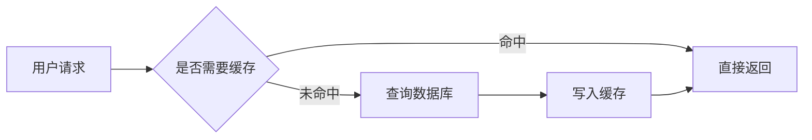

# Ramble Markdown

一个用 **Rust** 编写的轻量级 Markdown 编辑与实时预览桌面应用。单文件可执行、无需运行时依赖，双击即用。


---

## 目录

- [界面布局](#-界面布局)
- [功能特性](#-功能特性)
- [快速开始](#-快速开始)
- [快捷键](#️-快捷键)
- [右键菜单管理](#-右键菜单管理)
- [技术栈与实现](#-技术栈与实现)
- [项目结构](#-项目结构)
- [数据与缓存位置](#-数据与缓存位置)
- [测试](#-测试)
- [已知限制](#-已知限制)
- [待办](#-待办)
- [更新日志](#-更新日志)
- [关注公众号](#-关注公众号)

---

## 🖥 界面布局

```text
┌──────────────────────────────────────────────────────────────┐
│ ● Ramble Markdown │ 新建 打开 保存 另存为 最近 │ 分栏 编辑 预览 │ 100% 主题 │
├───────────────────────────────┬──────────────────────────────┤
│                               │                              │
│   Markdown 源文本              │   实时渲染预览                │
│   （可编辑，语法高亮）          │   （居中限宽，图片/图表）      │
│                               │                              │
├───────────────────────────────┴──────────────────────────────┤
│ ● 已保存 │ 268 词 · 1869 字符 · 122 行        分栏 · 100% · Ctrl+F 查找 │
└──────────────────────────────────────────────────────────────┘
```

分栏宽度可拖动；查找 / 替换栏从底部展开，不遮挡正文。

---

## ✨ 功能特性

### 编辑与预览

- **实时预览**：左侧编辑，右侧即时渲染，改一个字预览立刻更新
- **三档视图模式**：分栏（编辑 + 预览）/ 仅编辑 / 仅预览，一键切换
- **滚动随动**：拖动任意一侧的滚动条，另一侧按内容比例跟随滚动（双向同步，不会互相抖动）
- **可拖动分栏**：左右宽度自由拖拽调整
- **代码块语法高亮**：基于 syntect，覆盖 Rust / Python / JS / SQL / JSON / Shell 等主流语言
- **Markdown 支持**：标题、加粗 / 斜体 / 删除线、有序 / 无序 / 任务列表、引用、表格、分隔线、行内代码、代码块、链接、图片

### mermaid 图表

- 以 `mermaid` 标注的围栏代码块自动渲染为图片
- 支持流程图、时序图、状态图、类图、ER 图、饼图、甘特图、时间线、思维导图、gitGraph 等
- 图表配色跟随界面深浅主题，背景与预览区一致，中文标签优先使用系统中文字体
- 渲染失败时保留原始代码块并追加一行错误提示，方便定位语法问题

~~~text

~~~

### 图片（本地 / 网络 / SVG）

- 相对路径按**文档所在目录**解析，而不是程序启动目录：

  ```markdown
  
  ```

- 支持 `png` / `jpeg` / `gif` / `webp` / **SVG**，兼容 `data:` 内嵌图与 `file://` 绝对路径
- **网络图片**：`https://` 远程图异步拉取并缓存；SVG 按 Content-Type / 文件头识别，shields.io 徽章等无 `.svg` 后缀的链接也能渲染
- 路径含空格时按 Markdown 规范用尖括号包裹：

  ```markdown
  
  ```

- 图片按预览区宽度自动缩放，不会撑破版面

### 查找与替换

- `Ctrl + F` 查找、`Ctrl + H` 查找替换，`F3` / `Shift + F3` 上下跳转
- 支持大小写敏感开关、**反向查找**（勾选后 `Enter` 跳到上一个匹配）、匹配计数（如 `3 / 12`）、替换当前、全部替换
- 中英文混合文本安全匹配：按字符而非字节匹配，不会切坏多字节字符

### 文件操作

- 新建 / 打开 / 保存 / 另存为，支持把 `.md` 文件拖进窗口打开
- **最近打开列表**：工具栏「最近」菜单保留最近 10 个文件，已删除的文件会提示并自动清理
- 支持命令行传参：`ramble-markdown.exe 文档.md`
- **未保存保护**：关闭窗口或切换文件前弹窗确认（保存并继续 / 不保存 / 取消）
- 标题栏显示文件名与 `*` 脏标记；状态栏显示保存状态与词数 / 字符 / 行数
- 自动去除 UTF-8 BOM：记事本、PowerShell 保存的文件首行标题不会失效

### 界面

- **VSCode 风格配色**：面板、编辑区、预览区层次分明，状态栏保留 VSCode 蓝条
- **分段式工具栏**：文件操作、视图模式、查找、主题与缩放集中在一行
- **阅读区排版**：预览内容居中并限制最大行宽（860px），长文阅读更舒适
- **空状态引导**：空文档或新建文档时显示快捷键提示
- **暗色 / 浅色一键切换**（默认跟随系统主题），mermaid 图表同步换色
- 启动自动加载系统中文字体（优先微软雅黑 Light，回退雅黑 / 黑体 / 宋体），中文与 emoji 正常显示

### 性能与内存

- **渲染后端使用 glow（OpenGL）而非默认的 wgpu**：Windows/DX12 下 wgpu 会常驻数百 MB 驱动内存，换用 glow 后同一文档的私有内存从约 370 MB 降到约 145 MB
- 优先加载体积更小的「微软雅黑 Light」（11.6 MB，缺失时回退到雅黑/黑体/宋体），比常规雅黑节省约 15 MB
- 编辑时不克隆全文，预览与字数统计按需计算；空闲时不再逐帧重绘
- mermaid 结果以 PNG 落盘，按「源码 + 主题」哈希缓存，编辑正文时未改动的图表不会重渲染
- 不再生成 base64 字符串：预览文本更短，同一张图不会在内存里存两份
- 每次展开后回收当前文档不再使用的图表缓存与临时文件，缓存大小恒等于图表数量
- 图片纹理上传后立即释放解码像素副本（`reduce_texture_memory`），切换文档时释放旧图纹理
- 只加载一份 CJK 字体，避免多份字体常驻内存
- SVG 系统字体库走 mmap（`memmap-fonts`），不整份读进内存

> 实测环境：Windows、150% 显示缩放、12,697 字的纯中文文档，任务管理器工作集约 **200–210 MB**
>（优化前约 440 MB）。不同显卡驱动与 DPI 下数值会有差异；剩余占用主要来自 OpenGL 驱动、
> 中文字体与字形图集，属于 GUI 栈的固定开销。

### Windows 集成

- **右键菜单**：在资源管理器中对 `.md` / `.markdown` 文件右键 →「用 Ramble Markdown 打开」

---

## 🚀 快速开始

### 直接使用

1. 双击 `ramble-markdown.exe`
2. 或把 `.md` 文件拖进窗口
3. 或右键文件选择「用 Ramble Markdown 打开」（需先注册右键菜单）

### 从源码构建

环境要求：**Rust 1.85+**（支持 edition 2024）、Windows + MSVC 工具链，无其它系统依赖。

```bash
cd ramble-markdown
cargo build --release
# 产物：target/release/ramble-markdown.exe

# 构建并直接打开示例文档
cargo run --release -- 欢迎文档.md
```

---

## ⌨️ 快捷键

| 功能 | 快捷键 |
|------|--------|
| 新建 | `Ctrl + N` |
| 打开 | `Ctrl + O` |
| 保存 | `Ctrl + S` |
| 查找 | `Ctrl + F` |
| 查找 + 替换 | `Ctrl + H` |
| 下一个 / 上一个匹配 | `F3` / `Shift + F3` |
| 查找栏内跳转 | `Enter` / `Shift + Enter`（沿 / 逆当前查找方向） |
| 关闭查找栏 | `Esc` |
| 放大 / 缩小界面 | `Ctrl + =` / `Ctrl + -` |
| 重置界面缩放 | `Ctrl + 0` |
| 打开文件 | 把文件拖入窗口 |

---

## 🔧 右键菜单管理

注册表位置（当前用户，**无需管理员权限**）：

```text
HKEY_CURRENT_USER\Software\Classes\SystemFileAssociations\.md\shell\RambleMarkdown
```

**安装 / 更新**（PowerShell，先把 `$exe` 换成你的实际路径）：

```powershell
$exe = 'D:\Apps\ramble-markdown\ramble-markdown.exe'
foreach ($ext in '.md', '.markdown') {
    $key = "HKCU:\Software\Classes\SystemFileAssociations\$ext\shell\RambleMarkdown"
    New-Item -Path "$key\command" -Force | Out-Null
    Set-ItemProperty -Path $key -Name '(Default)' -Value '用 Ramble Markdown 打开'
    Set-ItemProperty -Path $key -Name 'Icon' -Value $exe
    Set-ItemProperty -Path "$key\command" -Name '(Default)' -Value ('"{0}" "%1"' -f $exe)
}
```

**卸载**：

```powershell
Remove-Item -Path 'HKCU:\Software\Classes\SystemFileAssociations\.md\shell\RambleMarkdown' -Recurse -Force
Remove-Item -Path 'HKCU:\Software\Classes\SystemFileAssociations\.markdown\shell\RambleMarkdown' -Recurse -Force
```

> 右键菜单指向注册时填写的 exe 路径。移动程序位置后，需要重新执行安装命令。

---

## 🏗 技术栈与实现

| 用途 | 依赖 |
|------|------|
| 窗口 / GUI | `eframe` 0.35（`egui` 0.35，**glow / OpenGL 后端**） |
| Markdown 渲染 | `egui_commonmark` 0.24（基于 `pulldown-cmark`，启用语法高亮、内嵌图片与网络图片拉取） |
| 代码高亮 | `syntect` 5（纯 Rust 正则后端，无需 C 编译器） |
| mermaid 渲染 | `mermaid-rs-renderer` 0.3.1（纯 Rust，无浏览器 / Node 依赖）+ resvg 栅格化 |
| 原生文件对话框 | `rfd` 0.17 |
| 图片解码 | `image` 0.25（png / jpeg / gif / webp，经 egui 图片加载器显示） |
| SVG 栅格化 | `resvg` 0.45（`egui_extras` svg / svg_text + 自定义 `SvgMimeLoader`，系统字体走 mmap） |

### mermaid 渲染管线

```text
mermaid 代码块
      ↓  mermaid_rs_renderer::render_with_options()   （解析 + 布局，纯 Rust）
   SVG 字符串
      ↓  write_output_png() → resvg                   （栅格化为 PNG）
   %TEMP%\ramble-markdown\mermaid\<hash>.png
      ↓  预览改写为 
 egui 图片加载器读取 → 纹理显示
```

要点：

- 缓存键为「源码 + 深浅主题」的 64 位哈希，未改动的图表不会重渲染
- 不生成 base64 字符串，预览文本更短，同一张图不会在内存中存两份
- 每次展开后只保留当前文档仍在使用的图表，旧版本连同 PNG 文件一起回收
- 未闭合的围栏（用户正在输入）原样输出，绝不篡改正文
- 图表渲染失败时降级为代码块 + 错误提示

### 图片路径解析

`egui_commonmark` 会把没有 scheme 的图片地址拼上 `default_implicit_uri_scheme`。
应用在加载文档时计算文档目录的 `file://` 前缀（`assets::image_base`），因此：

| 写法 | 实际解析 |
|------|----------|
| `` | `file:///<文档目录>/images/a.png` |
| `` | 带空格路径，按 Markdown 规范解析 |
| `` | 原样交给内嵌图片加载器 |
| `` | 原样使用绝对路径 |
| `` | 网络加载器异步拉取；SVG 按内容识别后栅格化 |

### 网络图片与 SVG

- `https://` 图片由 egui_extras HttpLoader 后台线程异步拉取，带字节缓存
- 上游 SvgLoader 只认 `.svg` 后缀的 URI；自定义 `SvgMimeLoader`（`src/svg_loader.rs`）按
  Content-Type / 文件头识别 SVG 再复用 resvg 栅格化，带缓存与帧末淘汰
- `svg_text` 特性加载系统字体，SVG 里的文字（徽章、图表标签）不会渲染成空白色块；
  字体走 mmap（`memmap-fonts`），不整份读进内存

### 滚动随动原理

每帧比较当前偏移与上一帧记录值，判断「是用户滚的还是程序滚的」，按 `偏移 / 最大偏移`
计算比例并写入对侧（`ScrollArea::vertical_scroll_offset`），从而避免两侧互相触发形成抖动。

---

## 📁 项目结构

```text
ramble-markdown/
├── Cargo.toml
├── Cargo.lock
├── build.rs                       # 链接预编译的图标/版本资源
├── README.md
├── ramble-markdown.exe            # 已构建的可执行文件（约 20.5 MB）
├── assets/
│   ├── app.ico                    # 多尺寸应用图标（16–256）
│   ├── app.rc                     # 图标 + VERSIONINFO 资源脚本
│   ├── app.res                    # windres 预编译资源（构建时直接链接）
│   ├── icon1024.png               # 图标母版
│   ├── icon256.png                # 运行时窗口图标
│   └── TechnologyRamble.jpg       # 公众号二维码（README / 欢迎文档引用）
├── 欢迎文档.md                     # 功能演示文档
├── 示例-图表与高亮.md               # mermaid / 高亮 / 查找替换测试文档
├── src/
│   ├── main.rs                    # 应用状态、UI 组装、快捷键、未保存确认
│   ├── assets.rs                  # 本地图片路径与图片管线
│   ├── theme.rs                   # 配色、字号与系统中文字体
│   ├── pane.rs                    # 编辑区 / 预览区
│   ├── mermaid.rs                 # mermaid 渲染与磁盘缓存（含单元测试）
│   ├── find.rs                    # 查找替换（含单元测试）
│   ├── recent.rs                  # 最近文件（含单元测试）
│   └── svg_loader.rs              # 按 MIME / 内容识别的 SVG 加载器
└── target/                        # 构建产物
```

模块职责：

| 模块 | 职责 |
|------|------|
| `main.rs` | `RambleApp` 状态机、`eframe::App` 实现、工具栏 / 状态栏 / 查找栏布局、快捷键、未保存确认 |
| `assets.rs` | 文档目录 → `file://` 前缀、图片管线配置 |
| `theme.rs` | VSCode Dark+ / Light+ 配色、全局 `Visuals` 与字号、CJK 字体加载 |
| `pane.rs` | 编辑区与预览区渲染，返回 `(滚动偏移, 最大偏移, 是否用户滚动)` |
| `mermaid.rs` | 围栏扫描、渲染、PNG 磁盘缓存、失败降级与临时文件清理 |
| `find.rs` | 查找 / 替换状态机与查找栏 UI |
| `recent.rs` | 最近文件列表的读写、去重与截断 |
| `svg_loader.rs` | 按 Content-Type / 文件头识别 SVG 并栅格化（补上游加载器只认 `.svg` 后缀的缺口） |

### 应用图标与版本信息

Windows 在不同位置取图标的来源不同：**资源管理器 / 快捷方式**读取 exe 内嵌的图标资源，
**任务栏 / Alt+Tab** 优先读取窗口图标，没有时回退到 exe 图标。因此只设置窗口图标时，
任务栏正常但资源管理器仍是空白图标——必须把图标编译进 exe 资源。

- `assets/app.ico`：16 / 24 / 32 / 48 / 64 / 128 / 256 多尺寸，256 使用 PNG 压缩条目
- `assets/app.res`：预编译的 Win32 资源（图标 + 文件版本信息），`build.rs` 通过
  `rustc-link-arg` 直接交给链接器，因此**构建时不需要安装 `rc.exe`**
- `assets/icon256.png`：运行时窗口图标，通过 `ViewportBuilder::with_icon` 加载
- 修改图标后重新生成资源（仅在改图标时需要，日常构建不需要）：

  ```bash
  windres -O res -i assets/app.rc -o assets/app.res
  ```

- 已存在的快捷方式若仍显示旧图标：删除并重新创建，或执行
  `ie4uinit.exe -show` 后重启资源管理器以刷新图标缓存。

---

## 💾 数据与缓存位置

| 内容 | 位置 | 说明 |
|------|------|------|
| 最近打开列表 | `%APPDATA%\ramble-markdown\recent.txt` | 纯文本，每行一个路径，可直接编辑或删除 |
| mermaid 临时图 | `%TEMP%\ramble-markdown\mermaid\*.png` | 按内容哈希命名，超过 24 小时的旧文件会在启动时清理 |

应用本身不写其它配置；删除上述目录即可恢复默认状态。

---

## ✅ 测试

```bash
cargo test
```

共 **20** 个用例，覆盖：

- mermaid：渲染成功、缓存命中、旧图表回收、非法语法降级、其它代码块不受影响、未闭合围栏原样保留
- 图片：Windows / Unix 路径转 URI、文档目录前缀、相对文件名回退
- 查找替换：大小写、中文、字符区间正确性、循环跳转、反向跳转、全部替换
- 最近文件：去重、置顶、数量截断

---

## ⚠️ 已知限制

- mermaid 支持流程图、时序图、状态图、类图、ER 图、饼图、甘特图、时间线、思维导图、gitGraph 等；复杂的 `%%{init}%%` 主题配置仅部分支持
- mermaid 图表渲染为位图，跟随界面缩放会略微模糊
- 超大分辨率图片仍会按原始尺寸上传纹理（显示时按宽度缩放），建议使用压缩后的图片
- 图片路径含空格时必须用 `<>` 包裹（Markdown 规范），否则会被解析成普通文本
- 使用 glow（OpenGL）后端以降低内存；极少数只支持软件 OpenGL 的虚拟机中帧率会偏低
- 目前仅测试于 Windows；字体加载逻辑包含 macOS / Linux 兜底路径但未验证

---

## 📌 待办

- [ ] 编辑器行号 / 当前行高亮
- [ ] 自动保存与文件变更外部监听
- [ ] 导出 HTML / PDF
- [ ] 大纲 / 目录侧栏
- [ ] 图片粘贴插入与拖拽到编辑器

---

## 📝 更新日志

### v0.5.0

- 新增 **SVG 图片渲染**：自定义 `SvgMimeLoader` 按 Content-Type / 文件头识别，兼容 shields.io 徽章等无 `.svg` 后缀的链接；系统字体渲染 SVG 文字
- 新增 **网络图片加载**：`https://` 远程图片异步拉取并缓存
- 查找栏新增 **反向查找** 选项：勾选后 `Enter` 跳上一个匹配、`Shift + Enter` 反方向
- 移除查找栏右侧关闭按钮，统一用 `Esc` 关闭
- README / 欢迎文档新增公众号二维码

### v0.4.0

- 新增 **本地图片支持**：相对路径按文档所在目录解析，支持 png / jpeg / gif / webp
- mermaid 流程图等图表配色跟随深浅主题，并优先使用系统中文字体
- mermaid 改为 **PNG 磁盘缓存 + 文件引用**，去掉 base64 内存中继
- 界面重做：分段式工具栏、居中限宽预览、空状态引导、状态栏缩略信息、圆角与阴影
- 新增 `Ctrl + =` / `Ctrl + -` / `Ctrl + 0` 界面缩放
- 内存优化：去掉逐帧全文克隆、预览 / 统计按需更新、空闲不再逐帧重绘、图片纹理及时释放
- **渲染后端从 wgpu 切换为 glow（OpenGL）**，中文字体改用更小的雅黑 Light，常驻内存下降约 60%
- 修复：带 UTF-8 BOM 的文件首行标题失效

---

## 📮 关注公众号

微信扫码关注「漫步科技」公众号：


