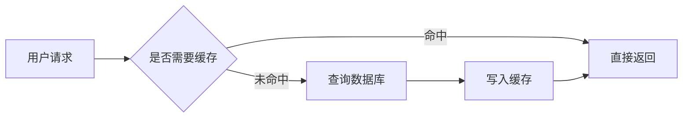
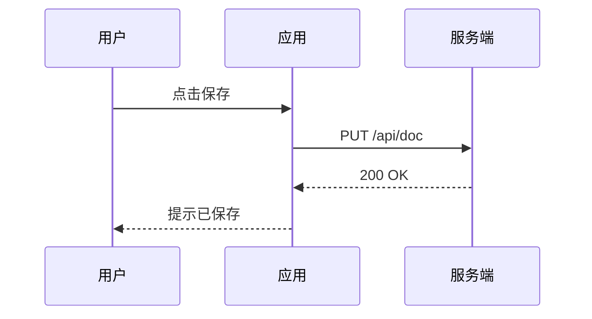
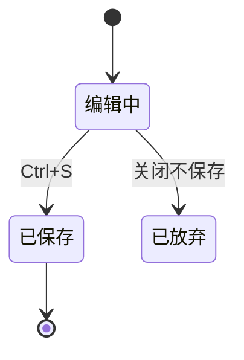
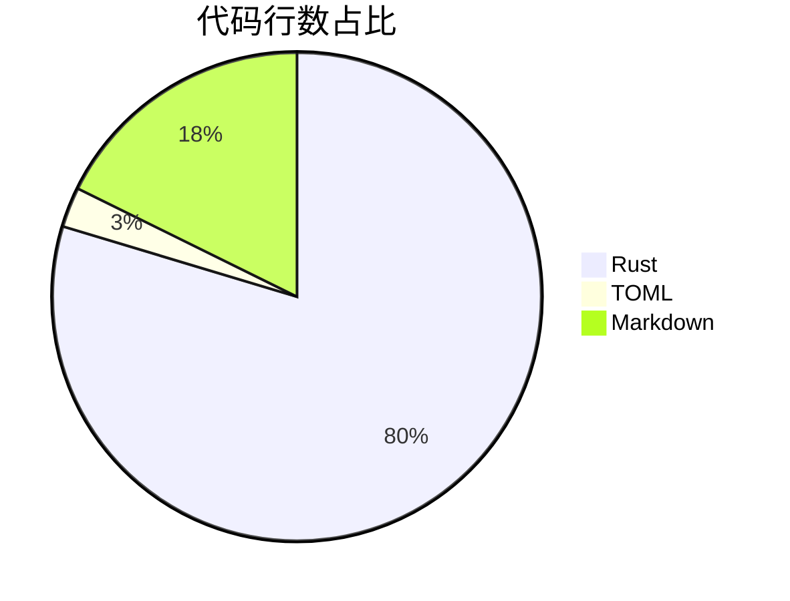

# 图表与高亮测试

本文档用于验证 Ramble Markdown 的图表渲染、语法高亮、查找替换与最近文件功能。

## 一、mermaid 图表

### 流程图



### 时序图



### 状态图



### 饼图



## 二、语法高亮

```rust
#[derive(Debug)]
struct Document {
    title: String,
    content: String,
}

impl Document {
    fn word_count(&self) -> usize {
        self.content.split_whitespace().count()
    }
}
```

```python
def fibonacci(n: int) -> int:
    """返回第 n 个斐波那契数"""
    a, b = 0, 1
    for _ in range(n):
        a, b = b, a + b
    return a
```

```javascript
const cache = new Map();
export function memoize(fn) {
  return (key) => {
    if (!cache.has(key)) cache.set(key, fn(key));
    return cache.get(key);
  };
}
```

```sql
SELECT u.name, COUNT(o.id) AS order_count
FROM users u
LEFT JOIN orders o ON o.user_id = u.id
WHERE u.created_at >= '2026-01-01'
GROUP BY u.name
ORDER BY order_count DESC
LIMIT 10;
```

```json
{
  "name": "ramble-markdown",
  "version": "0.3.0",
  "features": ["mermaid", "highlight", "find", "recent"]
}
```

## 三、查找替换测试区

下面几条重复文本可用于测试 Ctrl+F 查找与 Ctrl+H 替换：

- 待替换的目标词：苹果
- 待替换的目标词：苹果
- 待替换的目标词：苹果
- 大小写测试：Apple 与 apple 与 APPLE
- 中文查找测试：重庆、洪崖洞、解放碑、磁器口

## 四、表格与其他

| 功能 | 状态 | 备注 |
|------|------|------|
| mermaid 渲染 | ✅ | 支持 flowchart / sequence / state / pie 等 |
| 代码高亮 | ✅ | syntect 语法着色 |
| 查找替换 | ✅ | Ctrl+F / Ctrl+H / F3 |
| 最近文件 | ✅ | 工具栏「最近」菜单 |

> 提示：把 mermaid 源码改错（例如删掉一个 `-->`）可以看到渲染失败的降级提示。
